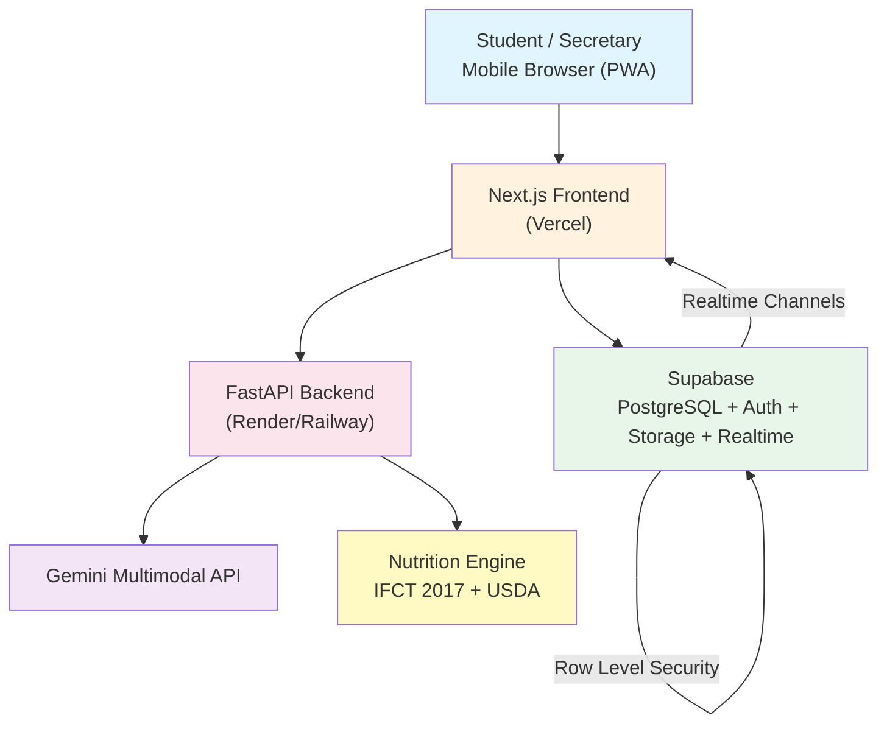
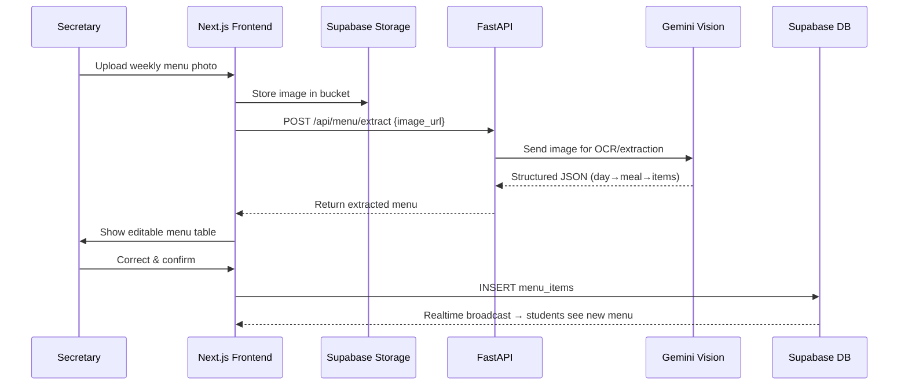
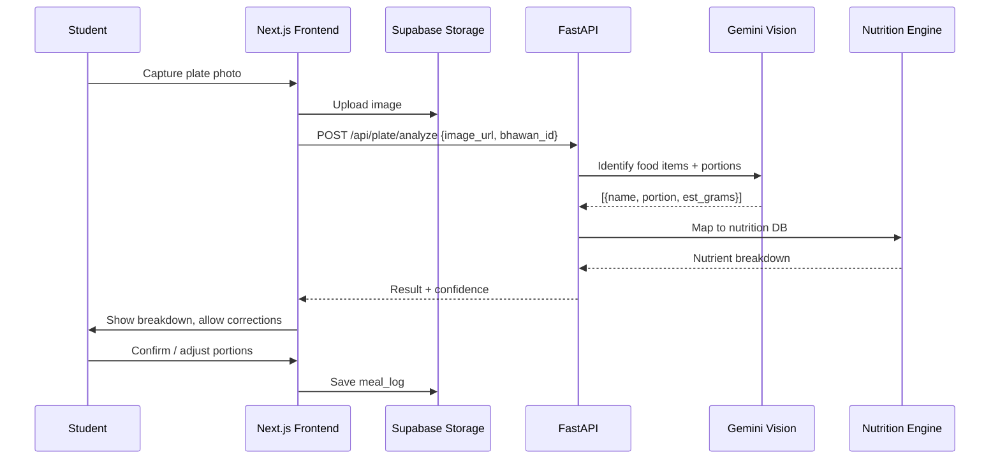
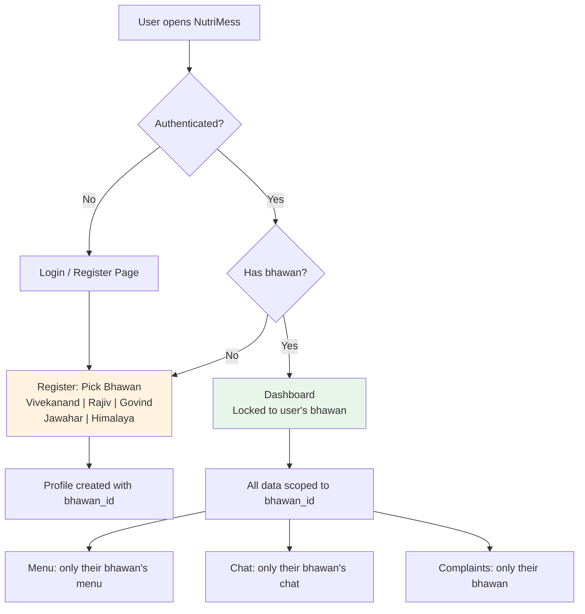

# NutriMess — Implementation Plan

## Goal Description

Build **NutriMess**, a Progressive Web App (PWA) for IIT Roorkee that serves as a dual-portal (Student + Mess Secretary) campus mess management and personalized nutrition platform. The app covers **5 Bhawans** (Vivekanand, Rajiv, Govind, Jawahar, Himalaya), with per-Bhawan weekly chat, AI-powered menu digitization, computer vision thali analysis, and a personalized nutrition assistant.

**Team:** Agrim, Akshat, Aditya (3 members)  
**Timeline:** 5 weeks development + 1.5 weeks deployment/outreach  

### Core UX Flow
```
Student scans QR / opens link
  → Installs PWA on home screen
  → Registers (picks one Bhawan)
  → Opens app → sees ONLY their Bhawan
  → Views weekly menu (uploaded by secretary as photo, AI-extracted)
  → Chats with other students about the menu (weekly cycle)
  → Scans plate → gets nutrition breakdown
  → Asks AI assistant for personalized advice
  → Files complaints
```

---

## User Review Required

> [!IMPORTANT]
> **Bhawan Lock-in**: The current plan locks a student to ONE bhawan at registration. If a student changes bhawan mid-semester, they'd need to update their profile. Confirm this is acceptable.

> [!IMPORTANT]
> **Weekly Chat Clearing**: Chats reset every week (matching the weekly mess schedule). Old chats are archived (soft-deleted) not hard-deleted, so data can be recovered if needed. Confirm this approach.

> [!IMPORTANT]
> **Authentication Method**: Plan uses Supabase Auth with email/password (IITR email). Should we also support Google OAuth (which most IITR students have via their `@iitr.ac.in` accounts)?

---

## Open Questions

> [!IMPORTANT]
> 1. **Secretary Onboarding**: How will mess secretaries be registered? Should there be a super-admin who creates secretary accounts, or should secretaries self-register with a special code?

> [!IMPORTANT]
> 2. **Gemini API Key**: Do you already have a Gemini API key, or should the plan account for setting one up? Which tier (free/paid)?

> [!IMPORTANT]
> 3. **Supabase Project**: Do you already have a Supabase project, or should we create one as part of Week 1?

> [!IMPORTANT]
> 4. **Domain/Hosting**: Will you use the default Vercel URL (e.g., `nutrimess.vercel.app`) or a custom domain?

---

## Architecture Overview



### Data Flow — Menu Upload


### Data Flow — Plate Analysis


---

## Tech Stack

| Layer | Technology | Purpose |
|-------|-----------|---------|
| Frontend | Next.js 14+ (App Router) + TypeScript | PWA, SSR, routing |
| UI | Tailwind CSS + shadcn/ui | Professional, mobile-first UI |
| PWA | `@serwist/next` (Serwist) | Service worker, offline support, installability |
| Database | Supabase PostgreSQL | All relational data |
| Auth | Supabase Auth | Email/password + optional Google OAuth |
| Storage | Supabase Storage | Menu images, plate photos |
| Realtime | Supabase Realtime (Channels) | Weekly per-Bhawan chat |
| Backend API | FastAPI (Python) | AI/CV pipelines, nutrition engine |
| Vision/AI | Google Gemini API (multimodal) | Menu OCR, food detection, AI chat |
| Nutrition Data | IFCT 2017 (seeded) + USDA FoodData Central (fallback API) | Indian food nutrition values |
| Deployment | Vercel (frontend) + Supabase (cloud) + Render (backend) | Free-tier friendly |

---

## Proposed Project Structure

```
nutrimess/
│
├── frontend/                          # Next.js PWA
│   ├── public/
│   │   ├── manifest.json             # PWA manifest
│   │   ├── sw.js                     # Service worker (generated by Serwist)
│   │   ├── icons/                    # PWA icons (192x192, 512x512, etc.)
│   │   │   ├── icon-192.png
│   │   │   ├── icon-512.png
│   │   │   └── apple-touch-icon.png
│   │   └── screenshots/             # PWA install screenshots
│   │
│   ├── src/
│   │   ├── app/                      # Next.js App Router
│   │   │   ├── layout.tsx            # Root layout (PWA meta, fonts)
│   │   │   ├── page.tsx              # Landing / Bhawan selection (locked to user's bhawan)
│   │   │   ├── globals.css           # Tailwind + global styles
│   │   │   │
│   │   │   ├── (auth)/               # Auth route group
│   │   │   │   ├── login/
│   │   │   │   │   └── page.tsx      # Login page
│   │   │   │   ├── register/
│   │   │   │   │   └── page.tsx      # Register (pick bhawan)
│   │   │   │   └── layout.tsx        # Auth layout (no sidebar)
│   │   │   │
│   │   │   ├── (student)/            # Student route group
│   │   │   │   ├── layout.tsx        # Student layout (bottom nav)
│   │   │   │   ├── dashboard/
│   │   │   │   │   └── page.tsx      # Home: today's menu + quick actions
│   │   │   │   ├── menu/
│   │   │   │   │   ├── page.tsx      # Full weekly menu view
│   │   │   │   │   └── [day]/
│   │   │   │   │       └── page.tsx  # Single day detail
│   │   │   │   ├── chat/
│   │   │   │   │   └── page.tsx      # Weekly Bhawan chat
│   │   │   │   ├── scan/
│   │   │   │   │   └── page.tsx      # Camera → plate analysis
│   │   │   │   ├── nutrition/
│   │   │   │   │   ├── page.tsx      # My nutrition dashboard
│   │   │   │   │   └── history/
│   │   │   │   │       └── page.tsx  # Meal history
│   │   │   │   ├── ai-chat/
│   │   │   │   │   └── page.tsx      # AI nutrition assistant
│   │   │   │   ├── complaints/
│   │   │   │   │   ├── page.tsx      # View my complaints
│   │   │   │   │   └── new/
│   │   │   │   │       └── page.tsx  # File new complaint
│   │   │   │   └── profile/
│   │   │   │       └── page.tsx      # User profile + nutrition goals
│   │   │   │
│   │   │   ├── (secretary)/          # Secretary route group
│   │   │   │   ├── layout.tsx        # Secretary layout
│   │   │   │   ├── dashboard/
│   │   │   │   │   └── page.tsx      # Secretary home
│   │   │   │   ├── menu-upload/
│   │   │   │   │   └── page.tsx      # Upload → extract → edit → publish
│   │   │   │   ├── complaints/
│   │   │   │   │   └── page.tsx      # Manage complaints
│   │   │   │   ├── chat/
│   │   │   │   │   └── page.tsx      # Participate in bhawan chat
│   │   │   │   └── analytics/
│   │   │   │       └── page.tsx      # Mess analytics
│   │   │   │
│   │   │   └── api/                  # Next.js API routes (proxy to FastAPI)
│   │   │       └── [...proxy]/
│   │   │           └── route.ts      # Optional: proxy requests to FastAPI
│   │   │
│   │   ├── components/               # Reusable UI components
│   │   │   ├── ui/                   # shadcn/ui components (auto-generated)
│   │   │   ├── layout/
│   │   │   │   ├── bottom-nav.tsx    # Mobile bottom navigation
│   │   │   │   ├── sidebar.tsx       # Desktop sidebar (secretary)
│   │   │   │   ├── header.tsx        # App header with bhawan name
│   │   │   │   └── pwa-install.tsx   # PWA install prompt
│   │   │   ├── menu/
│   │   │   │   ├── menu-card.tsx     # Single meal card
│   │   │   │   ├── weekly-menu.tsx   # Full week grid/list
│   │   │   │   ├── menu-editor.tsx   # Secretary: editable menu table
│   │   │   │   └── menu-uploader.tsx # Secretary: image upload + extract
│   │   │   ├── chat/
│   │   │   │   ├── chat-room.tsx     # Realtime chat container
│   │   │   │   ├── chat-message.tsx  # Single message bubble
│   │   │   │   ├── chat-input.tsx    # Message input + send
│   │   │   │   └── week-banner.tsx   # "Week of Oct 27 - Nov 2" header
│   │   │   ├── scan/
│   │   │   │   ├── camera-view.tsx   # Camera capture component
│   │   │   │   ├── plate-result.tsx  # Analysis results display
│   │   │   │   └── portion-editor.tsx # Adjust portions UI
│   │   │   ├── nutrition/
│   │   │   │   ├── nutrient-card.tsx # Macro/micro display card
│   │   │   │   ├── daily-summary.tsx # Today's intake summary
│   │   │   │   └── charts.tsx        # Nutrition charts (recharts)
│   │   │   ├── complaints/
│   │   │   │   ├── complaint-form.tsx
│   │   │   │   ├── complaint-card.tsx
│   │   │   │   └── status-badge.tsx
│   │   │   └── shared/
│   │   │       ├── bhawan-badge.tsx  # Bhawan name/icon badge
│   │   │       ├── loading.tsx       # Loading skeleton
│   │   │       └── empty-state.tsx   # Empty state illustrations
│   │   │
│   │   ├── lib/                      # Utility libraries
│   │   │   ├── supabase/
│   │   │   │   ├── client.ts         # Browser Supabase client
│   │   │   │   ├── server.ts         # Server-side Supabase client
│   │   │   │   ├── middleware.ts     # Auth middleware
│   │   │   │   └── storage.ts        # Storage upload helpers
│   │   │   ├── api.ts                # FastAPI client wrapper
│   │   │   ├── constants.ts          # Bhawan list, meal types, etc.
│   │   │   ├── utils.ts              # General utilities
│   │   │   └── hooks/
│   │   │       ├── use-auth.ts       # Auth hook
│   │   │       ├── use-bhawan.ts     # Current bhawan context
│   │   │       ├── use-chat.ts       # Realtime chat hook
│   │   │       └── use-camera.ts     # Camera access hook
│   │   │
│   │   ├── types/                    # TypeScript types
│   │   │   ├── database.ts           # Supabase generated types
│   │   │   ├── menu.ts               # Menu-related types
│   │   │   ├── nutrition.ts          # Nutrition types
│   │   │   ├── chat.ts               # Chat message types
│   │   │   └── user.ts               # User/profile types
│   │   │
│   │   └── middleware.ts             # Next.js middleware (auth guard + bhawan check)
│   │
│   ├── next.config.ts                # Next.js config (+ Serwist PWA config)
│   ├── tailwind.config.ts
│   ├── tsconfig.json
│   ├── components.json               # shadcn/ui config
│   ├── package.json
│   └── .env.local.example
│
├── backend/                           # FastAPI Python backend
│   ├── app/
│   │   ├── __init__.py
│   │   ├── main.py                   # FastAPI app entry point, CORS, lifespan
│   │   ├── config.py                 # Settings (env vars, API keys)
│   │   │
│   │   ├── api/                      # API route handlers
│   │   │   ├── __init__.py
│   │   │   ├── menu.py               # POST /menu/extract, GET /menu/{bhawan}
│   │   │   ├── plate.py              # POST /plate/analyze
│   │   │   ├── nutrition.py          # GET /nutrition/foods, POST /nutrition/calculate
│   │   │   ├── chat_ai.py            # POST /chat (AI nutrition assistant)
│   │   │   └── health.py             # GET /health
│   │   │
│   │   ├── services/                 # Business logic
│   │   │   ├── __init__.py
│   │   │   ├── menu_parser.py        # Gemini Vision → structured menu
│   │   │   ├── plate_analyzer.py     # Gemini Vision → food identification
│   │   │   ├── nutrition_engine.py   # Food → nutrient calculation
│   │   │   ├── recommender.py        # Rules-based recommendation engine
│   │   │   └── gemini_client.py      # Shared Gemini API client
│   │   │
│   │   ├── models/                   # Pydantic models
│   │   │   ├── __init__.py
│   │   │   ├── menu.py               # MenuExtraction, MenuItem
│   │   │   ├── plate.py              # PlateAnalysis, FoodItem
│   │   │   ├── nutrition.py          # NutrientBreakdown, DailyIntake
│   │   │   └── chat.py               # ChatRequest, ChatResponse
│   │   │
│   │   ├── prompts/                  # Gemini prompt templates
│   │   │   ├── menu_extraction.txt   # System prompt for menu OCR
│   │   │   ├── plate_analysis.txt    # System prompt for food detection
│   │   │   └── nutrition_chat.txt    # System prompt for AI assistant
│   │   │
│   │   └── data/                     # Static nutrition data
│   │       ├── ifct_2017.json        # ICMR-NIN food composition (seeded from PDF)
│   │       ├── mess_foods.json       # IITR-specific mess food database
│   │       └── serving_sizes.json    # Standard mess serving sizes
│   │
│   ├── requirements.txt
│   ├── Dockerfile                    # For Render/Railway deployment
│   └── .env.example
│
├── database/                          # Database schema & migrations
│   ├── schema.sql                    # Complete schema
│   ├── seed.sql                      # Seed data (bhawans, sample foods)
│   ├── rls_policies.sql              # Row Level Security policies
│   └── functions.sql                 # Database functions (chat cleanup, etc.)
│
├── docs/                             # Documentation
│   ├── setup.md                      # Local development setup guide
│   ├── deployment.md                 # Deployment guide
│   ├── api.md                        # API documentation
│   └── architecture.md              # Architecture decisions
│
├── .github/
│   └── workflows/
│       └── ci.yml                    # Basic CI (lint + type check)
│
├── .gitignore
├── README.md
└── .env.example                      # Root env example
```

---

## Proposed Changes

### 1. Database Schema

> The foundation of everything. This must be built first and built correctly.

#### [NEW] `database/schema.sql`

```sql
-- ============================================
-- NUTRIMESS DATABASE SCHEMA
-- ============================================

-- ENUMS
CREATE TYPE user_role AS ENUM ('student', 'secretary', 'admin');
CREATE TYPE meal_type AS ENUM ('breakfast', 'lunch', 'snacks', 'dinner');
CREATE TYPE day_of_week AS ENUM ('monday', 'tuesday', 'wednesday', 'thursday', 'friday', 'saturday', 'sunday');
CREATE TYPE complaint_status AS ENUM ('open', 'acknowledged', 'in_progress', 'resolved');
CREATE TYPE complaint_category AS ENUM ('food_quality', 'hygiene', 'quantity', 'menu', 'other');
CREATE TYPE menu_status AS ENUM ('draft', 'published', 'archived');
CREATE TYPE portion_size AS ENUM ('small', 'medium', 'large');

-- ============================================
-- BHAWANS (hostel mess units)
-- ============================================
CREATE TABLE bhawans (
  id UUID PRIMARY KEY DEFAULT gen_random_uuid(),
  name TEXT NOT NULL UNIQUE,
  code TEXT NOT NULL UNIQUE,  -- e.g., 'VB', 'RB', 'GB', 'JB', 'HB'
  description TEXT,
  image_url TEXT,
  created_at TIMESTAMPTZ DEFAULT now()
);

-- ============================================
-- USER PROFILES (extends Supabase auth.users)
-- ============================================
CREATE TABLE profiles (
  id UUID PRIMARY KEY REFERENCES auth.users(id) ON DELETE CASCADE,
  full_name TEXT NOT NULL,
  email TEXT NOT NULL,
  role user_role NOT NULL DEFAULT 'student',
  bhawan_id UUID NOT NULL REFERENCES bhawans(id),
  avatar_url TEXT,
  -- Nutrition profile fields
  age INTEGER,
  height_cm REAL,
  weight_kg REAL,
  activity_level TEXT,        -- sedentary, moderate, active, very_active
  goal TEXT,                  -- maintain, gain_muscle, lose_weight, balanced
  diet_preference TEXT,       -- veg, non_veg, egg
  allergies TEXT[],
  created_at TIMESTAMPTZ DEFAULT now(),
  updated_at TIMESTAMPTZ DEFAULT now()
);

-- ============================================
-- WEEKLY MENUS
-- ============================================
CREATE TABLE menus (
  id UUID PRIMARY KEY DEFAULT gen_random_uuid(),
  bhawan_id UUID NOT NULL REFERENCES bhawans(id),
  week_start DATE NOT NULL,          -- Monday of the week
  week_end DATE NOT NULL,            -- Sunday of the week
  image_url TEXT,                    -- Original uploaded menu image
  status menu_status DEFAULT 'draft',
  uploaded_by UUID REFERENCES profiles(id),
  published_at TIMESTAMPTZ,
  created_at TIMESTAMPTZ DEFAULT now(),
  updated_at TIMESTAMPTZ DEFAULT now(),
  UNIQUE(bhawan_id, week_start)      -- One menu per bhawan per week
);

CREATE TABLE menu_items (
  id UUID PRIMARY KEY DEFAULT gen_random_uuid(),
  menu_id UUID NOT NULL REFERENCES menus(id) ON DELETE CASCADE,
  day day_of_week NOT NULL,
  meal meal_type NOT NULL,
  item_name TEXT NOT NULL,
  item_order INTEGER DEFAULT 0,      -- Display order within meal
  food_id UUID REFERENCES food_items(id),  -- Link to nutrition DB
  created_at TIMESTAMPTZ DEFAULT now()
);

-- ============================================
-- NUTRITION FOOD DATABASE
-- ============================================
CREATE TABLE food_items (
  id UUID PRIMARY KEY DEFAULT gen_random_uuid(),
  name TEXT NOT NULL,
  name_hindi TEXT,
  category TEXT,                     -- grain, dal, vegetable, fruit, dairy, etc.
  default_serving_unit TEXT,         -- katori, piece, glass, plate
  default_grams REAL,               -- grams per default serving
  -- Per 100g values
  calories_per_100g REAL,
  protein_per_100g REAL,
  carbs_per_100g REAL,
  fat_per_100g REAL,
  fiber_per_100g REAL,
  iron_per_100g REAL,
  calcium_per_100g REAL,
  -- Source
  source TEXT,                       -- 'IFCT2017', 'USDA', 'custom'
  source_id TEXT,                    -- ID in source database
  is_mess_specific BOOLEAN DEFAULT false,
  created_at TIMESTAMPTZ DEFAULT now()
);

-- ============================================
-- BHAWAN CHAT (weekly, per-bhawan)
-- ============================================
CREATE TABLE chat_weeks (
  id UUID PRIMARY KEY DEFAULT gen_random_uuid(),
  bhawan_id UUID NOT NULL REFERENCES bhawans(id),
  week_start DATE NOT NULL,
  week_end DATE NOT NULL,
  menu_id UUID REFERENCES menus(id),  -- Link to that week's menu
  is_active BOOLEAN DEFAULT true,
  created_at TIMESTAMPTZ DEFAULT now(),
  UNIQUE(bhawan_id, week_start)
);

CREATE TABLE chat_messages (
  id UUID PRIMARY KEY DEFAULT gen_random_uuid(),
  chat_week_id UUID NOT NULL REFERENCES chat_weeks(id) ON DELETE CASCADE,
  user_id UUID NOT NULL REFERENCES profiles(id),
  content TEXT NOT NULL,
  image_url TEXT,                     -- Optional image attachment
  reply_to UUID REFERENCES chat_messages(id),  -- Thread support
  created_at TIMESTAMPTZ DEFAULT now()
);

-- ============================================
-- PLATE ANALYSIS & MEAL LOGS
-- ============================================
CREATE TABLE meal_logs (
  id UUID PRIMARY KEY DEFAULT gen_random_uuid(),
  user_id UUID NOT NULL REFERENCES profiles(id),
  bhawan_id UUID NOT NULL REFERENCES bhawans(id),
  meal_type meal_type NOT NULL,
  meal_date DATE NOT NULL DEFAULT CURRENT_DATE,
  image_url TEXT,                    -- Plate photo
  ai_raw_response JSONB,            -- Raw Gemini response (for debugging)
  user_confirmed BOOLEAN DEFAULT false,
  total_calories REAL,
  total_protein REAL,
  total_carbs REAL,
  total_fat REAL,
  total_fiber REAL,
  confidence TEXT,                   -- low, moderate, high
  created_at TIMESTAMPTZ DEFAULT now()
);

CREATE TABLE meal_log_items (
  id UUID PRIMARY KEY DEFAULT gen_random_uuid(),
  meal_log_id UUID NOT NULL REFERENCES meal_logs(id) ON DELETE CASCADE,
  food_name TEXT NOT NULL,
  food_id UUID REFERENCES food_items(id),
  portion portion_size DEFAULT 'medium',
  estimated_grams REAL,
  calories REAL,
  protein REAL,
  carbs REAL,
  fat REAL,
  fiber REAL,
  ai_detected BOOLEAN DEFAULT true,
  user_corrected BOOLEAN DEFAULT false
);

-- ============================================
-- COMPLAINTS
-- ============================================
CREATE TABLE complaints (
  id UUID PRIMARY KEY DEFAULT gen_random_uuid(),
  bhawan_id UUID NOT NULL REFERENCES bhawans(id),
  user_id UUID NOT NULL REFERENCES profiles(id),
  category complaint_category NOT NULL,
  description TEXT NOT NULL,
  image_url TEXT,
  is_anonymous BOOLEAN DEFAULT false,
  status complaint_status DEFAULT 'open',
  secretary_response TEXT,
  responded_by UUID REFERENCES profiles(id),
  responded_at TIMESTAMPTZ,
  created_at TIMESTAMPTZ DEFAULT now(),
  updated_at TIMESTAMPTZ DEFAULT now()
);

-- ============================================
-- AI CHAT HISTORY
-- ============================================
CREATE TABLE ai_chat_sessions (
  id UUID PRIMARY KEY DEFAULT gen_random_uuid(),
  user_id UUID NOT NULL REFERENCES profiles(id),
  created_at TIMESTAMPTZ DEFAULT now()
);

CREATE TABLE ai_chat_messages (
  id UUID PRIMARY KEY DEFAULT gen_random_uuid(),
  session_id UUID NOT NULL REFERENCES ai_chat_sessions(id) ON DELETE CASCADE,
  role TEXT NOT NULL,                -- 'user' or 'assistant'
  content TEXT NOT NULL,
  metadata JSONB,                    -- Context used (menu, logs, etc.)
  created_at TIMESTAMPTZ DEFAULT now()
);

-- ============================================
-- INDEXES
-- ============================================
CREATE INDEX idx_profiles_bhawan ON profiles(bhawan_id);
CREATE INDEX idx_menus_bhawan_week ON menus(bhawan_id, week_start);
CREATE INDEX idx_menu_items_menu ON menu_items(menu_id);
CREATE INDEX idx_chat_messages_week ON chat_messages(chat_week_id);
CREATE INDEX idx_chat_messages_created ON chat_messages(created_at);
CREATE INDEX idx_meal_logs_user_date ON meal_logs(user_id, meal_date);
CREATE INDEX idx_complaints_bhawan ON complaints(bhawan_id);
CREATE INDEX idx_complaints_status ON complaints(status);
```

#### [NEW] `database/seed.sql`

```sql
-- Seed 5 IIT Roorkee Bhawans
INSERT INTO bhawans (name, code, description) VALUES
  ('Vivekanand Bhawan', 'VB', 'Vivekanand Bhawan Mess'),
  ('Rajiv Bhawan', 'RB', 'Rajiv Bhawan Mess'),
  ('Govind Bhawan', 'GB', 'Govind Bhawan Mess'),
  ('Jawahar Bhawan', 'JB', 'Jawahar Bhawan Mess'),
  ('Himalaya Bhawan', 'HB', 'Himalaya Bhawan Mess');

-- Seed common mess food items (IFCT 2017 based)
-- (50+ items covering typical IITR mess foods)
INSERT INTO food_items (name, category, default_serving_unit, default_grams,
  calories_per_100g, protein_per_100g, carbs_per_100g, fat_per_100g, 
  fiber_per_100g, source) VALUES
  ('Jeera Rice', 'grain', 'katori', 180, 150, 2.7, 31.0, 1.5, 0.4, 'custom'),
  ('Plain Dal (Arhar)', 'dal', 'katori', 150, 110, 7.0, 15.0, 2.5, 3.0, 'IFCT2017'),
  ('Chapati/Roti', 'grain', 'piece', 40, 240, 7.5, 50.0, 1.5, 3.5, 'IFCT2017'),
  -- ... (full list to be populated during Week 1)
  ('Aloo Sabzi', 'vegetable', 'katori', 120, 95, 2.0, 17.0, 3.0, 2.0, 'IFCT2017');
```

#### [NEW] `database/rls_policies.sql`

```sql
-- ============================================
-- ROW LEVEL SECURITY POLICIES
-- ============================================

-- Enable RLS on all tables
ALTER TABLE profiles ENABLE ROW LEVEL SECURITY;
ALTER TABLE menus ENABLE ROW LEVEL SECURITY;
ALTER TABLE menu_items ENABLE ROW LEVEL SECURITY;
ALTER TABLE chat_weeks ENABLE ROW LEVEL SECURITY;
ALTER TABLE chat_messages ENABLE ROW LEVEL SECURITY;
ALTER TABLE meal_logs ENABLE ROW LEVEL SECURITY;
ALTER TABLE complaints ENABLE ROW LEVEL SECURITY;

-- PROFILES: Users can read own profile, update own profile
CREATE POLICY "Users can view own profile"
  ON profiles FOR SELECT USING (auth.uid() = id);
CREATE POLICY "Users can update own profile"
  ON profiles FOR UPDATE USING (auth.uid() = id);

-- MENUS: Students see published menus for their bhawan only
CREATE POLICY "Students see own bhawan published menus"
  ON menus FOR SELECT USING (
    bhawan_id = (SELECT bhawan_id FROM profiles WHERE id = auth.uid())
    AND (status = 'published' OR uploaded_by = auth.uid())
  );
-- Secretaries can manage menus for their bhawan
CREATE POLICY "Secretaries manage own bhawan menus"
  ON menus FOR ALL USING (
    EXISTS (
      SELECT 1 FROM profiles 
      WHERE id = auth.uid() 
      AND role = 'secretary' 
      AND bhawan_id = menus.bhawan_id
    )
  );

-- CHAT: Only bhawan members can read/write chat
CREATE POLICY "Bhawan members access chat"
  ON chat_messages FOR ALL USING (
    EXISTS (
      SELECT 1 FROM chat_weeks cw
      JOIN profiles p ON p.bhawan_id = cw.bhawan_id
      WHERE cw.id = chat_messages.chat_week_id
      AND p.id = auth.uid()
    )
  );

-- MEAL LOGS: Users can only see/create their own
CREATE POLICY "Users manage own meal logs"
  ON meal_logs FOR ALL USING (user_id = auth.uid());

-- COMPLAINTS: Students see own, secretaries see bhawan's
CREATE POLICY "Students see own complaints"
  ON complaints FOR SELECT USING (
    user_id = auth.uid() OR
    EXISTS (
      SELECT 1 FROM profiles 
      WHERE id = auth.uid() 
      AND role = 'secretary' 
      AND bhawan_id = complaints.bhawan_id
    )
  );
```

#### [NEW] `database/functions.sql`

```sql
-- ============================================
-- DATABASE FUNCTIONS
-- ============================================

-- Auto-create/rotate chat weeks
-- Called by a cron job or on menu publish
CREATE OR REPLACE FUNCTION create_chat_week(
  p_bhawan_id UUID,
  p_week_start DATE,
  p_menu_id UUID DEFAULT NULL
) RETURNS UUID AS $$
DECLARE
  v_chat_week_id UUID;
BEGIN
  -- Deactivate previous weeks for this bhawan
  UPDATE chat_weeks 
  SET is_active = false 
  WHERE bhawan_id = p_bhawan_id AND is_active = true;
  
  -- Create new chat week
  INSERT INTO chat_weeks (bhawan_id, week_start, week_end, menu_id, is_active)
  VALUES (p_bhawan_id, p_week_start, p_week_start + 6, p_menu_id, true)
  ON CONFLICT (bhawan_id, week_start) 
  DO UPDATE SET is_active = true, menu_id = COALESCE(p_menu_id, chat_weeks.menu_id)
  RETURNING id INTO v_chat_week_id;
  
  RETURN v_chat_week_id;
END;
$$ LANGUAGE plpgsql SECURITY DEFINER;

-- Get current week's chat for a bhawan
CREATE OR REPLACE FUNCTION get_active_chat_week(p_bhawan_id UUID)
RETURNS UUID AS $$
  SELECT id FROM chat_weeks 
  WHERE bhawan_id = p_bhawan_id 
  AND is_active = true 
  LIMIT 1;
$$ LANGUAGE sql STABLE;

-- Auto-create profile on signup (trigger)
CREATE OR REPLACE FUNCTION handle_new_user()
RETURNS TRIGGER AS $$
BEGIN
  INSERT INTO profiles (id, full_name, email, role, bhawan_id)
  VALUES (
    NEW.id,
    COALESCE(NEW.raw_user_meta_data->>'full_name', ''),
    NEW.email,
    COALESCE((NEW.raw_user_meta_data->>'role')::user_role, 'student'),
    (NEW.raw_user_meta_data->>'bhawan_id')::UUID
  );
  RETURN NEW;
END;
$$ LANGUAGE plpgsql SECURITY DEFINER;

CREATE TRIGGER on_auth_user_created
  AFTER INSERT ON auth.users
  FOR EACH ROW EXECUTE FUNCTION handle_new_user();
```

---

### 2. Frontend — Next.js PWA Setup

#### [NEW] `frontend/public/manifest.json`

```json
{
  "name": "NutriMess - IITR Mess Nutrition",
  "short_name": "NutriMess",
  "description": "AI-powered mess nutrition tracker for IIT Roorkee",
  "start_url": "/dashboard",
  "display": "standalone",
  "background_color": "#ffffff",
  "theme_color": "#16a34a",
  "orientation": "portrait",
  "icons": [
    { "src": "/icons/icon-192.png", "sizes": "192x192", "type": "image/png" },
    { "src": "/icons/icon-512.png", "sizes": "512x512", "type": "image/png" },
    { "src": "/icons/icon-512.png", "sizes": "512x512", "type": "image/png", "purpose": "maskable" }
  ],
  "screenshots": [
    { "src": "/screenshots/home.png", "sizes": "390x844", "type": "image/png", "form_factor": "narrow" }
  ]
}
```

#### [NEW] `frontend/next.config.ts`

Key PWA configuration using `@serwist/next`:

```typescript
import withSerwistInit from "@serwist/next";

const withSerwist = withSerwistInit({
  swSrc: "src/sw.ts",
  swDest: "public/sw.js",
  cacheOnNavigation: true,
  reloadOnOnline: true,
});

const nextConfig = {
  // ... other config
};

export default withSerwist(nextConfig);
```

#### [NEW] `frontend/src/middleware.ts`

Auth guard + bhawan enforcement:

```typescript
import { createServerClient } from '@supabase/ssr';
import { NextResponse, type NextRequest } from 'next/server';

export async function middleware(request: NextRequest) {
  // 1. Check authentication
  // 2. If authenticated, verify user has a bhawan set
  // 3. For student routes, verify bhawan access
  // 4. For secretary routes, verify secretary role
  // 5. Redirect unauthenticated users to /login
}

export const config = {
  matcher: ['/(student)/:path*', '/(secretary)/:path*', '/dashboard/:path*'],
};
```

---

### 3. Key Frontend Design & UI System

The application follows the **Forestry & Terracotta Modern** design system (strict adherence to the `mobile-app-ui-design` skill):
- **Aesthetic**: Minimalist Editorial Light Mode (inspired by Apple Health, Levels, and Linear).
- **Color System (60/30/10 Rule)**:
  - **60% Neutral Base**: Warm porcelain background (`#F9FAFB`), crisp pure white surface containers (`#FFFFFF`), whisper-thin hairline borders (`#E5E7EB` / `rgba(0,0,0,0.06)`), and soft ambient shadows (`0 1px 3px rgba(0,0,0,0.04), 0 4px 12px rgba(0,0,0,0.02)`).
  - **30% Structure & Content**: Deep slate headings (`#111827`), balanced secondary text (`#4B5563`), and muted metadata (`#9CA3AF`).
  - **10% Brand Accent**: Deep botanical pine green (`#244E3D`) for primary controls and active indicators; warm terracotta (`#BA5D38`) for verified secretary badges, protein callouts, and feast alerts.
- **Iconography**: 100% vector line icons with 1.5px stroke width (Lucide / Material Symbols Outlined). Zero emojis in UI chrome.
- **Typography & Grid**: Single typeface (**Inter**), strictly max 4 sizes, 2 weights (Medium 500, Semibold 600), monospace tabular numbers for macros and calories, 8-point spatial rhythm.

#### Core Screen Architecture

1. **Student Dashboard (`/dashboard`)**:
   - Top Bar: Minimalist botanical brand mark, `Rajiv Bhawan` pill badge, 44pt notification button.
   - Live Status: Real-time service pill (`Lunch Active • 12:15 – 2:15 PM`) with soft emerald pulse dot.
   - Today's Schedule Card: Structured cards for Breakfast (Past), Lunch (Current service highlighted with left accent and macro pill `680 kcal • 28g Protein`), and Dinner (Upcoming).
   - Daily Nutrition Target: Tabular tracker (`1,420 / 2,200 kcal`, `58/85g Protein`, `180/240g Carbs`, `42/65g Fats`) with 6px linear progress bars.
   - Quick Actions: Dual high-reach cards in thumb zone for `Scan Meal Plate` and `Bhawan Community`.
   - Floating Bottom Nav: 5-tab docked pill (Home, Menu, Scan, Chat, Profile).

2. **Bhawan Community Chat (`/chat`)**:
   - Header: Back arrow, `Rajiv Bhawan Mess Community`, active student count, weekly cycle reset notice.
   - Pinned Official Notice: High-trust announcement card authored by `Rohan Sharma (Mess Secy)` with verified badge.
   - Feed: Anonymous student feedback, incoming clean white cards, outgoing subtle pine wash bubbles, and an embedded `Daily Mess Quality Poll` with live percentage bars.
   - Input Bar: Ergonomic thumb-zone composer with attachment, camera review, and deep pine circular send button.

3. **Login & Campus Onboarding (`/login`)**:
   - Value Prop: Collegiate sign-in with full-width Google OAuth button (`Continue with IITR Google Account`).
   - Selection Over Manual Input: 6-bhawan responsive selection grid (RB, CB, GB, JB, KB, SB) and dietary preference chips.
   - Administrative Key Entry: Discreet link for Mess Secretaries to authenticate via 16-bit hash.

4. **Plate Scan & AI Meal Recognition (`/scan`)**:
   - Viewfinder: Clean targeting camera frame with corner crosshairs focusing on Indian steel thali.
   - AI Segmentation: Real-time detected bounding pills (`Paneer Bhurji`, `Dal Tadka`, `Jeera Rice`, `Phulka`).
   - Nutrition & Portions: Monospace `680 kcal` callout, macro pill badges, itemized granular steppers (`[- 1 bowl +]`), and primary `Log to Daily Nutrition` CTA.

5. **Weekly Mess Menu (`/menu`)**:
   - Horizontal Weekday Strip: Mon–Sun dates with `Today (Sat 14)` active pine pill.
   - Meal Filter Chips: Quick toggles for All, Breakfast, Lunch, Dinner.
   - Service Breakdown & Weekend Feature: Detailed menus with macro estimates and Sunday Banquet notice.

6. **Secretary Administration Portal (`/secretary`)**:
   - Header: Verified executive badge (`16-bit Hash Verified • RB-8F42`) with student view switch.
   - Key Metrics: Active service plate counter (`342 / 420 plates`) and weekly student satisfaction (`4.2 / 5.0`).
   - Operation Hub: Quick actions to edit today's menu, broadcast pinned chat notices, and approve next week's schedule.
   - Real-time Student Feedback: Anonymous feedback stream with 1-tap administrative response tools.

**Chat implementation details:**
- Uses **Supabase Realtime Channels** (broadcast mode) for instant message delivery
- Messages are also persisted to `chat_messages` table
- Each bhawan has one active `chat_week` at a time
- When a new week starts (or secretary publishes new menu), a new `chat_week` is created
- Old messages remain in DB but the UI only shows the **active week's** chat
- The weekly menu image is pinned at the top of the chat as context
- Secretary messages get a special badge/color

---

### 4. Backend — FastAPI API Design

#### [NEW] `backend/app/main.py`

```python
from fastapi import FastAPI
from fastapi.middleware.cors import CORSMiddleware

app = FastAPI(title="NutriMess API", version="1.0.0")

app.add_middleware(
    CORSMiddleware,
    allow_origins=["https://nutrimess.vercel.app", "http://localhost:3000"],
    allow_credentials=True,
    allow_methods=["*"],
    allow_headers=["*"],
)

# Routes
app.include_router(menu_router, prefix="/api/menu", tags=["Menu"])
app.include_router(plate_router, prefix="/api/plate", tags=["Plate Analysis"])
app.include_router(nutrition_router, prefix="/api/nutrition", tags=["Nutrition"])
app.include_router(chat_ai_router, prefix="/api/chat", tags=["AI Chat"])
```

#### API Endpoints

| Method | Endpoint | Description | Auth |
|--------|----------|-------------|------|
| `POST` | `/api/menu/extract` | Upload menu image → Gemini extracts structured data | Secretary |
| `POST` | `/api/plate/analyze` | Upload plate image → identify foods + nutrition | Student |
| `POST` | `/api/chat` | AI nutrition assistant query | Student |
| `GET` | `/api/nutrition/foods` | Search food database | Any |
| `POST` | `/api/nutrition/calculate` | Calculate nutrients for food items | Any |
| `GET` | `/api/health` | Health check | Public |

#### [NEW] `backend/app/services/menu_parser.py`

```python
import google.generativeai as genai

async def extract_menu_from_image(image_url: str) -> dict:
    """
    Send menu image to Gemini Vision API.
    Returns structured JSON:
    {
      "monday": {
        "breakfast": ["Poha", "Jalebi", ...],
        "lunch": ["Dal", "Rice", ...],
        "dinner": [...]
      },
      ...
    }
    """
    model = genai.GenerativeModel("gemini-2.0-flash")
    # Carefully crafted prompt for Indian mess menu extraction
    # Returns structured JSON that secretary can review/edit
```

#### [NEW] `backend/app/services/plate_analyzer.py`

```python
async def analyze_plate(image_url: str, bhawan_id: str) -> PlateAnalysis:
    """
    1. Send plate image to Gemini Vision
    2. Get identified food items + estimated portions
    3. Match to nutrition database (IFCT/mess_foods)
    4. Calculate total nutrients
    5. Return with confidence score
    """
```

#### [NEW] `backend/app/services/nutrition_engine.py`

```python
class NutritionEngine:
    """
    Core calculation engine:
    - Load IFCT 2017 data + mess-specific foods
    - Map food name → food_item record
    - Calculate nutrients for given portion
    - Fallback to USDA API if food not found locally
    """
    
    def calculate(self, items: list[DetectedFood]) -> NutrientBreakdown:
        """For each detected food item, look up per-100g values,
        multiply by estimated_grams, sum totals."""
```

---

### 5. PWA Configuration

#### Key PWA Features

| Feature | Implementation |
|---------|---------------|
| **Installable** | `manifest.json` + service worker via Serwist |
| **Camera access** | `navigator.mediaDevices.getUserMedia()` for live camera, `<input type="file" accept="image/*" capture="environment">` as fallback |
| **Offline shell** | Cache app shell (HTML/CSS/JS) for instant load; data requires network |
| **Push notifications** | Future P2 (not in MVP) |
| **Home screen icon** | PWA manifest icons + apple-touch-icon |
| **Splash screen** | Configured via manifest `background_color` + `theme_color` |

#### Service Worker Strategy
```
- App shell: CacheFirst (HTML, CSS, JS, icons)
- API calls: NetworkFirst (always try fresh data)
- Images: StaleWhileRevalidate (show cached, update in background)
- Plate photos: NetworkOnly (must upload fresh)
```

---

### 6. Bhawan-Locked Access Flow



**Enforcement layers:**
1. **Supabase RLS**: Database policies filter by `bhawan_id` matching the user's profile
2. **Next.js Middleware**: Server-side check before rendering pages
3. **Frontend context**: `useBhawan()` hook provides bhawan data to all components

---

## Week-by-Week Development Plan

### Week 1 — Foundation + Auth + Bhawan System

**Owner split:** Agrim (DB + Auth), Akshat (Frontend scaffold + PWA), Aditya (Backend scaffold)

| Task | Details | Owner |
|------|---------|-------|
| Init Next.js project | `create-next-app` with TypeScript, Tailwind, App Router | Akshat |
| Setup shadcn/ui | Install + configure base components | Akshat |
| PWA setup | Serwist, manifest.json, icons, service worker | Akshat |
| Create Supabase project | Database, Auth, Storage buckets | Agrim |
| Database schema | Run `schema.sql`, `seed.sql`, `rls_policies.sql` | Agrim |
| Auth pages | Login, Register (with bhawan picker) | Akshat |
| Supabase Auth integration | Client/server helpers, middleware, session | Agrim |
| Init FastAPI project | Project structure, CORS, health endpoint | Aditya |
| Bottom nav + layouts | Student layout, secretary layout, responsive | Akshat |
| Bhawan selection UI | Registration bhawan picker, profile page | Akshat |

**✅ Milestone:** Login → Register (pick Rajiv Bhawan) → Dashboard shows "Rajiv Bhawan" → Secretary login → Secretary dashboard

---

### Week 2 — Menu System + Chat + Complaints

**Owner split:** Agrim (Chat system), Akshat (Menu UI), Aditya (Menu extraction API)

| Task | Details | Owner |
|------|---------|-------|
| Menu upload UI | Secretary: drag-drop image upload | Akshat |
| Gemini menu extraction | FastAPI endpoint + Gemini Vision prompt | Aditya |
| Menu editor UI | Secretary: review, edit, publish extracted menu | Akshat |
| Menu display | Student: today's menu, weekly menu view | Akshat |
| Chat system backend | `chat_weeks` + `chat_messages` + Supabase Realtime | Agrim |
| Chat UI | Message list, input, realtime updates, week banner | Agrim |
| Chat week rotation | Auto-create new chat week on menu publish | Agrim |
| Complaint form | Category, description, photo upload, anonymous option | Akshat |
| Complaint dashboard | Secretary: view, acknowledge, respond, resolve | Akshat |
| Supabase Storage | Configure buckets: `menu-images`, `plate-images`, `complaints` | Agrim |

**✅ Milestone:** Upload your actual mess menu image → AI extracts it → Secretary edits → Publishes → Students see menu → Chat about it in weekly chat room → File a complaint

---

### Week 3 — Plate Analyzer + Nutrition Engine

**Owner split:** Aditya (CV + Nutrition engine), Agrim (DB + meal logs), Akshat (Scan UI)

| Task | Details | Owner |
|------|---------|-------|
| Camera capture UI | Camera view, capture button, image preview | Akshat |
| Plate analysis API | FastAPI + Gemini Vision for food detection | Aditya |
| Nutrition engine | IFCT data loading, food matching, calculation | Aditya |
| Plate result UI | Show detected foods, portions, nutrients | Akshat |
| Portion editor | Let user correct AI (small/medium/large) | Akshat |
| Meal log storage | Save confirmed analyses to `meal_logs` | Agrim |
| IFCT data seeding | Process IFCT 2017 PDF → JSON → DB seed | Aditya |
| Mess food database | Populate IITR-specific foods and servings | Aditya |
| Nutrition dashboard | Daily summary, macro breakdown cards | Akshat |

**✅ Milestone:** Take plate photo → AI identifies "Rice, Dal, Aloo" → Shows nutrition breakdown → User confirms → Saved to meal log → Dashboard shows daily intake

---

### Week 4 — AI Assistant + Personalization + Polish

**Owner split:** Aditya (AI chat), Agrim (Personalization), Akshat (UI polish)

| Task | Details | Owner |
|------|---------|-------|
| User profile form | Age, weight, height, goal, diet, allergies | Akshat |
| AI chat API | FastAPI + Gemini with context injection | Aditya |
| AI chat UI | Chat interface with message history | Akshat |
| Context builder | Pull user profile + today's menu + meal history for AI | Aditya |
| Recommendation engine | Rules-based: goal → available menu → suggest foods | Aditya |
| Meal history page | Past meal logs with nutrition data | Akshat |
| Secretary analytics | Basic stats: complaints count, active users | Agrim |
| Chat enhancements | Reply threading, secretary badge, image attachments | Agrim |
| UI polish | Animations, loading states, error states, empty states | Akshat |
| PWA refinements | Install prompt, offline page, app-like transitions | Akshat |

**✅ Milestone:** Complete end-to-end flow: Menu upload → Menu display → Plate scan → Nutrition result → AI gives personalized recommendation using today's menu + user profile

---

### Week 5 — Integration Testing + Deployment

**Owner split:** All three on testing + deployment

| Task | Details | Owner |
|------|---------|-------|
| End-to-end testing | Full pipeline test (secretary → student) | All |
| Mobile testing | Android Chrome, iOS Safari, different screens | All |
| Security audit | RLS verification, API key protection, input validation | Agrim |
| Performance | Image optimization, lazy loading, caching | Akshat |
| Deploy frontend | Vercel deployment + custom domain (if any) | Akshat |
| Deploy backend | Render/Railway + environment variables | Aditya |
| QR code generation | Generate QR codes for each bhawan | Agrim |
| Documentation | README, setup guide, API docs | All |
| Bug fixes | Fix issues found during testing | All |

**✅ Milestone:** Live app accessible via QR code. Secretary can upload menu, students can chat, scan plates, get recommendations, file complaints.

---

### Week 5.5–6.5 — Campus Deployment & Outreach

| Day | Activity |
|-----|----------|
| 1–2 | Demo to mess secretaries, onboard 1–2 bhawans |
| 3–4 | QR codes in mess halls, WhatsApp group announcement |
| 5–7 | Monitor real usage, fix common issues |
| 8–10 | Iterate based on feedback, improve AI prompts |

---

## Verification Plan

### Automated Tests

```bash
# Frontend
cd frontend
pnpm run lint          # ESLint
pnpm run type-check    # TypeScript strict
pnpm run build         # Verify production build works

# Backend
cd backend
python -m pytest tests/              # Unit tests
python -m pytest tests/ -m "integration"  # Integration tests

# Database
# Verify RLS policies by attempting cross-bhawan access
```

### Manual Verification

1. **PWA Install**: Open on Android Chrome → "Add to Home Screen" prompt appears → App opens standalone
2. **Bhawan Lock**: Register as Rajiv Bhawan student → Cannot access Govind Bhawan data
3. **Menu Flow**: Upload menu image → AI extracts → Edit → Publish → Student sees menu
4. **Chat**: Two students in same bhawan can chat in realtime; student from different bhawan cannot see messages
5. **Chat Weekly Reset**: Publish new week's menu → New chat week starts → Old messages hidden
6. **Plate Scan**: Capture plate photo → Food identified → Nutrition calculated → User can correct portions
7. **AI Chat**: Ask "What should I eat for dinner?" → AI references today's actual menu
8. **Complaint**: Student files complaint → Secretary sees it → Acknowledges → Resolves
9. **Responsive**: Test on mobile viewport (375px), tablet (768px), desktop (1280px)
10. **Offline**: Open app → Go offline → App shell loads → Shows "You're offline" for data

---

## Risk Mitigation

| Risk | Mitigation |
|------|-----------|
| Gemini API rate limits on free tier | Cache menu extractions; batch plate analyses; implement retry logic |
| IFCT 2017 data only in PDF format | Pre-process and seed as JSON/SQL during setup — one-time manual effort |
| Camera access denied by user | Provide fallback file upload input (`<input type="file" capture>`) |
| Supabase free tier limits (500MB DB, 1GB storage) | Compress images before upload; archive old chat weeks; monitor usage |
| Poor food recognition accuracy | Always allow user correction; improve prompts iteratively; track accuracy |
| Realtime chat scaling | Supabase free tier supports 200 concurrent connections — sufficient for MVP |
